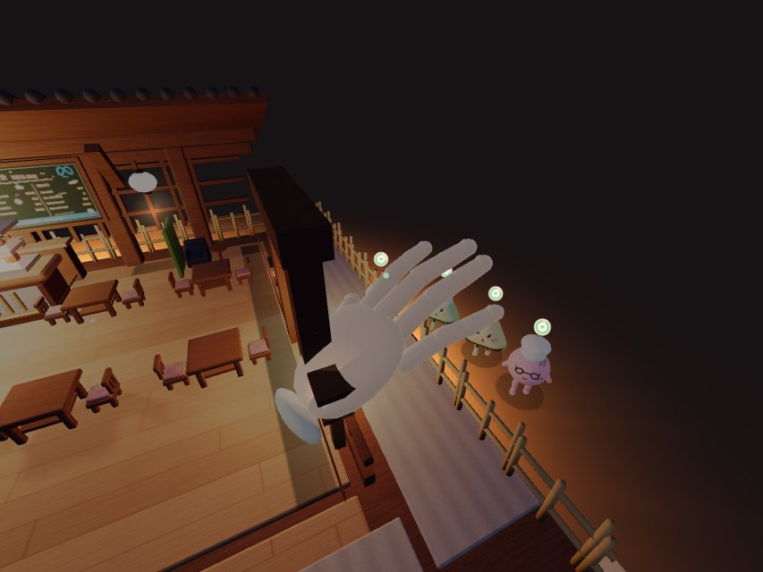

<p align="center">
  
</p>

<p align="center">
  <b>A small café on your real table. Pinch each guest into the seat it wants.</b><br>
  A hands-only mixed-reality seating puzzle for Meta Quest 3 and 3S. You play it seated.
</p>

<p align="center">
  <a href="https://gurneeshbudhiraja.github.io/cafe-chaos/"></a>
</p>

<p align="center">
  
  
  
  
</p>

<p align="center">
  <a href="#play-it">Play it</a> ·
  <a href="#how-to-play">How to play</a> ·
  <a href="#two-cafés">Two cafés</a> ·
  <a href="#built-for-hands-and-mixed-reality">Built for hands</a> ·
  <a href="#run-it-yourself">Run it yourself</a> ·
  <a href="#inside-the-repo">Inside the repo</a>
</p>

---

<p align="center">
  
</p>

## The idea

Café Chaos puts a café the size of your hand on the table in front of you.
Small guests walk to its gate and wait.

1. Pinch a guest between two fingers.
2. Carry it over the café.
3. Open your hand. The guest hops onto the seat that glows under it.

The baristas bring the food. A fed guest pays you. A guest that waits too
long leaves unhappy.

Each guest wants something: a window seat, a quiet table, a seat by the fire,
or the table where its friend sits. The line grows while you decide. Use your
coins to buy more tables and hire more staff.

You play seated, with your bare hands, in passthrough. One press on the start
card opens the café. A level takes a few minutes.

Entry for the **Meta VR Start Developer Competition 2026** (Gaming track, New
Experience).

## Play it

1. On a Meta Quest 3 or 3S, open
   **[gurneeshbudhiraja.github.io/cafe-chaos](https://gurneeshbudhiraja.github.io/cafe-chaos/)**
   in the Quest browser.
2. Sit at a table or a desk. Do not hold your controllers.
3. Press **Enter AR**. The café appears on the table in front of you.

You do not need an install or an account. The browser keeps your save. The
game pauses when you remove the headset.

## How to play

| | |
|:-:|:-:|
|  |  |
| **Pinch a guest.** Put your fingers above a guest at the gate. When the guest glows, pinch. | **Seat the guest.** Move it over the café and open your fingers. It goes to the seat that glows. |
|  |  |
| **Read the guest.** The dial over its head shows the patience left. An hourglass means a guest in a hurry. Hearts mean two friends. | **Keep the café happy.** Serve enough guests to finish the level. A met wish pays more. If happiness goes to zero, you play the level again. You keep your coins and staff. |

The bar over the café has **Pause** at the left end and **Shop** at the right
end. Point your hand at the bar and pinch.

### The guests' wishes

Each guest shows its wish on a card:

- A seat that meets the whole wish pays the most.
- A seat that meets part of the wish pays less.
- The guest refuses a seat that meets none of the wish.

New kinds of wish appear one at a time. Each new kind first appears on a
guest with only that wish. Thus a new player meets most kinds in about five
minutes.

- **Places:** a window seat, by the gate, by the baristas, a big table, inside,
  by the fireplace, at the bonfire, by the lake, upstairs.
- **Company:** a table to myself, with other guests, with my friend, with my
  own kind, with someone in a hat.
- **People:** meet a named guest, keep away from a guest, keep away from
  hurried guests. When you hold the guest that a named guest looks for, the
  named guest glows.
- **Music:** near the singer or the musicians, or a quiet seat far from them.

The first three guests of a run have one easy wish each. From level 3, some
guests have two wishes. From level 5, some guests have three. Two wishes on
one guest never contradict each other. The game offers a wish only if a seat
can meet it before the guest's patience ends.

## Two cafés

|  |  |
|:-:|:-:|
| **Japanese café** | **Canadian café** |
| A cherry-blossom tea garden at dusk. Paper lanterns light as the room around you gets darker. Your first café. | A log cabin in the snow, with a fireplace, an upper deck, a patio, a bonfire, a frozen lake and live music. |
| Guests: mochi, onigiri and tofu. | Guests: snowbit, beavertail, nanaimo, double-double and butter tart. |
| Hire up to two more baristas and a janitor. Singing guests arrive from level 3. | Hire up to two more servers, two janitors, a fiddler and a pianist. Cold guests want a fire. A snowstorm starts at level 2. |
| Free. You always keep it. | The first 3 levels are free. To keep your progress, buy it for 750 coins from the Japanese café. |

Each café has its own save: coins, tables, staff and level.

## Built for hands and mixed reality

Meta asks for experiences that are seated, fully usable with hands, quick to
start and satisfying in ten minutes or less. Café Chaos follows these rules
from the start.

- **The café is on your real table.** Plane detection finds the table. The
  café sits on it, at table height, and faces you. A WebXR anchor keeps the
  café in place while the headset improves its map of the room.
- **Pinch what you see.** The game picks the guest behind your fingers along
  your line of sight. Thus you never reach across the table. The pinch holds
  until your fingers are well apart. A short loss of tracking does not drop
  the guest.
- **Your real hands stay in front.** The game does not draw the café where
  your hand is. Your hand covers the café as it covers a real model.
- **Clear feedback for each state.** A free hand near a guest shows a warm
  ring around the guest. A seat glows mint, violet or red to show if the guest
  takes it. A short reason and a sound come with the colour. Colour is never
  the only signal.
- **Menus for hands.** Cards stand about one metre away, a little below eye
  level. Their buttons are sized for the hand ray. Pinch with the ray from a
  distance, or look at a button and pinch.
- **Move the café.** Pinch the handle under the café to move it. Pinch the
  corner brackets to turn it or change its size.
- **Teach by doing.** The first run teaches one action at a time, with short
  clips from the game. How to play is always one pinch away.
- **Comfort.** The game has no locomotion and no camera motion. Nothing
  appears suddenly near your face. The passthrough gets slowly darker for the
  night café and stays clear for the day café.

### Made for a standalone headset

- The game merges the café's furniture into one mesh for each material. The
  full room needs only a few dozen draw calls.
- The materials use Lambert shading, which costs less. Texture detail and
  baked ambient occlusion keep the look.
- The game draws the shadow map again only when something in the café
  changes, not on each frame.
- The game asks the Quest browser for a steady 72 Hz. To see the frame rate in
  the headset, add `?fps` to the address.

## Run it yourself

You need Node.js 20.19+, 22.12+ or 24.

```bash
cd cafe-chaos/game
npm install
npm run dev
```

`npm run dev` opens the game in a browser with the Immersive Web Emulator. The
emulator shows a virtual Quest in a living room with a table.

**On a Quest:**

1. The dev server prints a network HTTPS address on port 8082. Open it in the
   Quest browser on the same Wi-Fi.
2. Accept the certificate warning.
3. Sit at a table and press **Enter AR**.

Over USB, run `adb reverse tcp:8082 tcp:8082` and open `https://localhost:8082`.

```bash
npm run typecheck   # TypeScript
npm run build       # static site in dist/
```

Each push to `main` builds the game and publishes it to GitHub Pages
(`.github/workflows/deploy-pages.yml`).

### Checks

Test scripts play the game in the emulator as a player does. Each script
prints PASS or FAIL for each rule. Start the dev server, then run the check
for the part that you changed:

```bash
node scripts/check-wish-rules.mjs   # wishes: one on the first guests, none that contradict, all meetable
node scripts/check-levels.mjs       # levels, goals and saving the level
node scripts/check-start-card.mjs   # the start card and the café picker
```

[`cafe-chaos/game/scripts`](cafe-chaos/game/scripts) has 33 checks. They
include placement on the table, pinch and carry, seating, cleaning, the staff,
pause, saving and sound. To play a run that does not read or write the save,
add `?test` to the address.

## Inside the repo

```
cafe-chaos/
  game/                 the game (IWSDK, three.js, TypeScript, Vite)
    src/
      systems/          the café, guests, baristas, game flow, shop, mood, frame budget
      guests/           wishes, the cast, a guest's model, its dial, the seat glow
      game/rules.ts     every number: levels, pay, patience, prices
      cafe/             the floor plans of both cafés, batching, materials
      ui/               the start menu, the cards and their buttons
    public/models/      the glTF models the game loads
    scripts/            emulator checks and recordings
    docs/               the plans, the design notes and the review
  models/               the Blender build scripts for every model
  docs/game-brief.md    the original brief
```

For a full tour of the code, read
[`cafe-chaos/game/README.md`](cafe-chaos/game/README.md). For the models and
their sizes, read [`cafe-chaos/START-HERE.md`](cafe-chaos/START-HERE.md).

## Built with

- [Immersive Web SDK](https://developers.meta.com/horizon/documentation/web/iwsdk-overview/)
  1.0 (Meta): the world, hand input, plane detection, anchors and the
  emulator.
- [three.js](https://threejs.org/) r181 and WebXR.
- [Blender](https://www.blender.org/), with Python scripts, for every model,
  texture and animation.
- [Rough.js](https://roughjs.com/) for the hand-drawn cards.
- [pure-rand](https://github.com/dubzzz/pure-rand) for the seeded order in
  which tables open.

## Credits

- Theme music: "Tokyo Sunset (Lofi, Peaceful, Soft)" by HoliznaCC0, CC0 1.0
  ([details](cafe-chaos/game/public/audio/CREDITS.md)). The game makes every
  other sound in code with the Web Audio API.
- Fonts, both under the SIL Open Font License 1.1: Jost for the game's text
  ([licence](cafe-chaos/game/public/fonts/OFL-Jost.txt)) and Fredoka for the
  logo ([licence](cafe-chaos/game/assets/source/fonts/OFL.txt)).
- The models, the textures and the art are original to this game.
