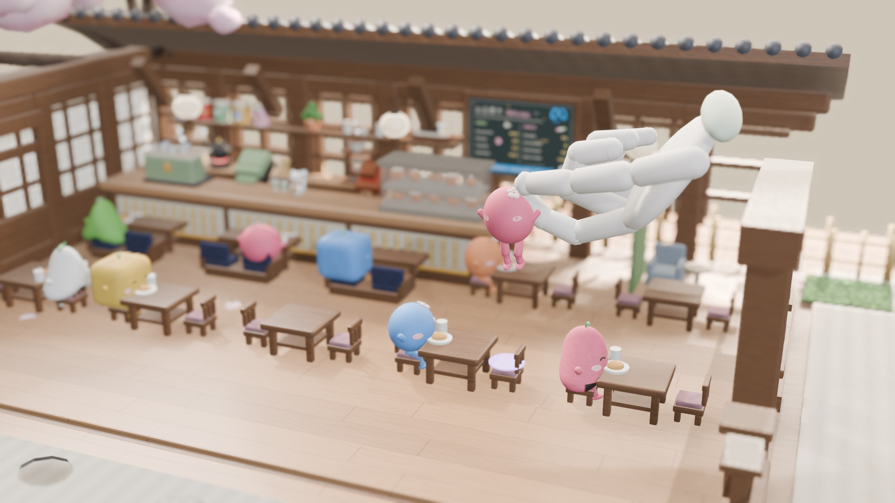
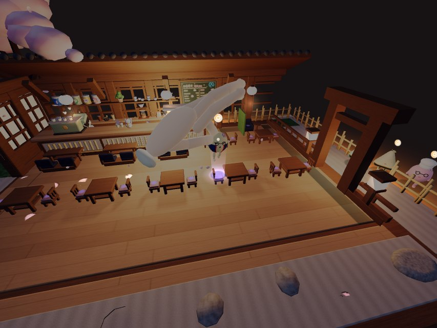
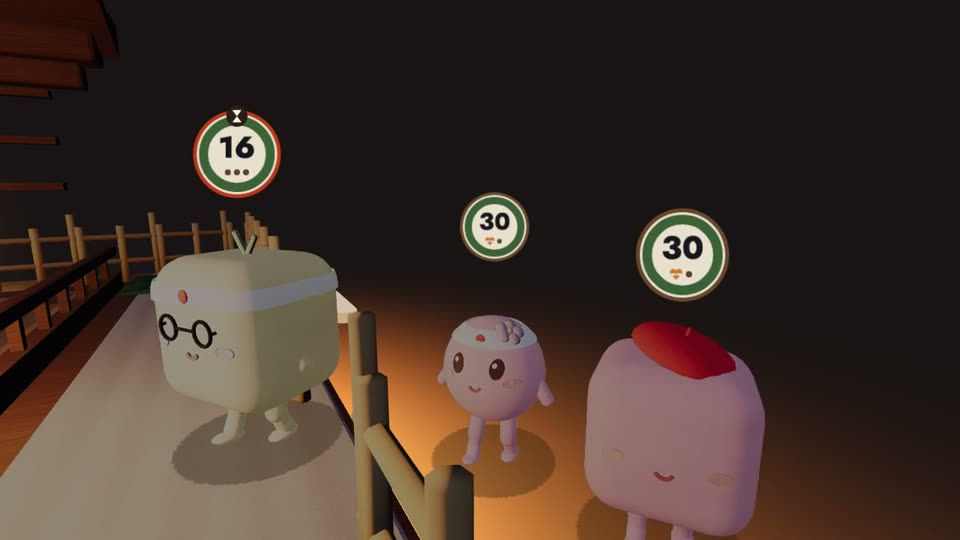
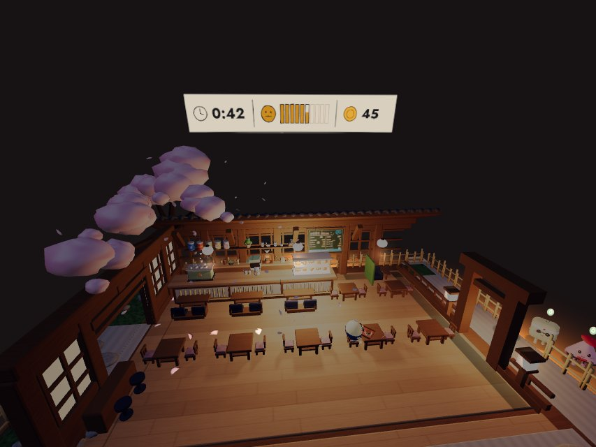
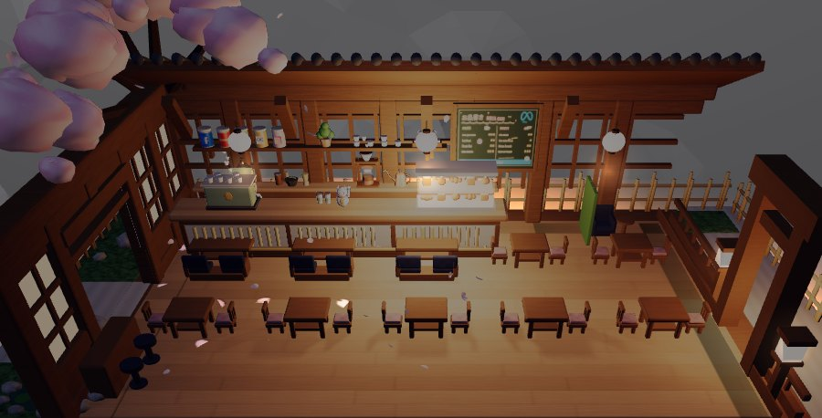
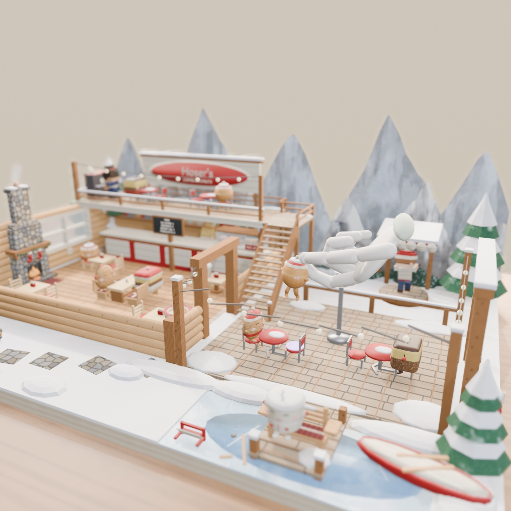

<p align="center">
  
</p>

<p align="center">
  <b>A tiny café on your real table. Pinch guests into the seats they wish for.</b><br>
  A hands-only mixed-reality seating puzzle for Meta Quest 3 and 3S, played sitting down.
</p>

<p align="center">
  <a href="https://gurneeshbudhiraja.github.io/cafe-chaos/"></a>
</p>

<p align="center">
  
  
  
  
  
  
</p>

<p align="center">
  <a href="#play-it">Play it</a> ·
  <a href="#how-to-play">How to play</a> ·
  <a href="#two-cafés">Two cafés</a> ·
  <a href="#built-for-hands-and-mixed-reality">Built for hands</a> ·
  <a href="#run-it-yourself">Run it yourself</a> ·
  <a href="#inside-the-repo">Inside the repo</a>
</p>

---

<p align="center">
  
</p>

## The idea

Café Chaos puts a hand-sized café on the table in front of you. Small guests
walk up to its gate and wait. You pinch one up between two fingers, carry it
over the café and open your hand. It hops onto the seat glowing under it. The
baristas bring its food. A fed guest pays you, and a guest kept waiting walks
off unhappy.

Every guest wants something: a window seat, a quiet table, a seat by the
fire, the table where its friend sits. The line keeps growing while you
decide. Spend your coins on more tables and more staff, then try to keep up.

It is played seated, with bare hands, in passthrough. One press on the start
card opens the café, and a level lasts a few minutes.

Built for the **Meta VR Start Developer Competition 2026** (Gaming track, New
Experience).

## Play it

1. On a Meta Quest 3 or 3S, open
   **[gurneeshbudhiraja.github.io/cafe-chaos](https://gurneeshbudhiraja.github.io/cafe-chaos/)**
   in the Quest browser.
2. Sit at a table or a desk and put your controllers down.
3. Press **Enter AR**. The café comes up on the table in front of you.

No install and no account. The game saves itself in the browser, and it
pauses when you take the headset off.

## How to play

| | |
|:-:|:-:|
|  |  |
| **Pinch a guest.** Put your fingers above a guest at the gate. When it glows, pinch. | **Seat it.** Move it over the café and open your fingers. It goes to the seat that glows. |
|  |  |
| **Read the guest.** The dial over its head counts down its patience. An hourglass means it is in a hurry. Hearts mean two friends. | **Keep the café happy.** Serve enough guests to finish the level. Granted wishes pay more. If happiness runs out, you play the level again and keep your coins and staff. |

The bar over the café has **Pause** at the left end and **Shop** at the right
end. Point your hand at it and pinch.

### The guests' wishes

Each guest shows its wish on a card. A guest seated where its wish is met
pays the most, a guest seated where part of it is met pays less, and a guest
refuses a seat that meets none of it. New kinds of wish come in one at a
time, each first on a guest with only that wish, so a new player meets most
of them within about five minutes:

- **Places:** a window seat, by the gate, by the baristas, a big table, inside,
  by the fireplace, at the bonfire, by the lake, upstairs.
- **Company:** a table to myself, with other guests, with my friend, with my
  own kind, with someone in a hat.
- **People:** meet a named guest (it glows while you hold the one looking for
  it), keep away from someone, keep away from hurried guests.
- **Music:** near the singer or the musicians, or a quiet seat far from them.

The first three guests of a run have one easy wish each. From level 3 some
guests have two wishes, and from level 5 some have three. Wishes never
contradict each other, and a wish is only offered if a seat can meet it
before the guest runs out of patience.

## Two cafés

|  |  |
|:-:|:-:|
| **Japanese café** | **Canadian café** |
| A cherry-blossom tea garden at dusk. Paper lanterns come up as the room around you dims. Your first café. | A snowy log cabin with a fireplace, an upper deck, a patio, a bonfire, a frozen lake and live music. |
| Guests: mochi, onigiri and tofu. | Guests: snowbit, beavertail, nanaimo, double-double and butter tart. |
| Hire up to two more baristas and a janitor. Singing guests arrive from level 3. | Hire up to two more servers, two janitors, a fiddler and a pianist. Cold guests want a fire, and a snowstorm blows in at level 2. |
| Free, and always yours. | Play the first 3 levels free. Buy it for 750 coins earned in the Japanese café to keep your progress. |

Each café keeps its own save: its coins, tables, staff and level.

## Built for hands and mixed reality

Meta asks for experiences that are seated, fully usable with hands, quick to
start and satisfying within ten minutes. Café Chaos was designed around those
rules from the first day.

- **The café lands on your real table.** Plane detection finds the table, and
  the café sits on it, at table height, facing you. A WebXR anchor keeps it
  there while the headset refines its map of the room.
- **Pinch what you see.** A guest is under your pinch when it is behind your
  fingers along your line of sight, so you never reach across the table. The
  pinch holds until your fingers are well apart, so a tracking flicker never
  drops a guest.
- **Your real hands stay in front.** The café is not drawn where your hand
  is, so your own hand covers it as it would cover a real model.
- **Clear feedback for every state.** A free hand near a guest lights it with
  a warm ring. A seat glows mint, violet or red to say whether the guest will
  take it, with a short reason and a sound. Colour is never the only signal.
- **Menus for hands.** Cards stand about a metre away, a little below eye
  level, with buttons sized for the hand ray. Pinch with the ray from a
  distance, or look and pinch.
- **Move the café.** Pinch the handle under the café to move it, and the
  corner brackets to turn or resize it.
- **Teach by doing.** The first run teaches one move at a time, with short
  clips recorded from the game. How to play is always one pinch away.
- **Comfort.** No locomotion, no camera motion, and nothing appears suddenly
  close. The passthrough dims gently for the night café and stays clear by
  day.

### Made to run on a standalone headset

- The café's furniture is merged into one mesh per material, so the whole
  room draws in a few dozen draw calls.
- Materials are swapped to cheaper Lambert shading. Texture detail and baked
  ambient occlusion keep the look.
- The shadow map is redrawn only when something in the café changes, not on
  every frame.
- The game asks the Quest browser for a steady 72 Hz. Add `?fps` to the
  address to see the frame rate in the headset.

## Run it yourself

You need Node.js 20.19+, 22.12+ or 24.

```bash
cd cafe-chaos/game
npm install
npm run dev
```

`npm run dev` opens the game in a browser with the Immersive Web Emulator, a
virtual Quest in a living room with a table.

**On a Quest:** the dev server prints a network HTTPS address on port 8082.
Open it in the Quest browser on the same Wi-Fi, accept the certificate
warning, and press **Enter AR** at a table. Over USB, run
`adb reverse tcp:8082 tcp:8082` and open `https://localhost:8082`.

```bash
npm run typecheck   # TypeScript
npm run build       # static site in dist/
```

Every push to `main` builds the game and publishes it to GitHub Pages
(`.github/workflows/deploy-pages.yml`).

### Checks

The game is tested by scripts that play it in the emulator, as a player
would, and print PASS or FAIL for each rule. Start the dev server, then run
the check for the part you changed:

```bash
node scripts/check-wish-rules.mjs   # wishes: one on the first guests, none that contradict, all meetable
node scripts/check-levels.mjs       # levels, goals and saving the level
node scripts/check-start-card.mjs   # the start card and the café picker
```

There are 33 checks in [`cafe-chaos/game/scripts`](cafe-chaos/game/scripts):
placement on the table, pinching and carrying, seating, cleaning, the staff,
pause, saving, sound and more. Add `?test` to the address for a run that
never reads or writes the save.

## Inside the repo

```
cafe-chaos/
  game/                 the game (IWSDK, three.js, TypeScript, Vite)
    src/
      systems/          the café, guests, baristas, game flow, shop, mood, frame budget
      guests/           wishes, the cast, a guest's model, its dial, the seat glow
      game/rules.ts     every number: levels, pay, patience, prices
      cafe/             the floor plans of both cafés, batching, materials
      ui/               the start menu, the cards and their buttons
    public/models/      the glTF models the game loads
    scripts/            emulator checks and recordings
    docs/               the plans, the design notes and the review
  models/               the Blender build scripts for every model
  docs/game-brief.md    the original brief
```

Start with [`cafe-chaos/game/README.md`](cafe-chaos/game/README.md) for the
full tour of the code, and
[`cafe-chaos/START-HERE.md`](cafe-chaos/START-HERE.md) for the models and how
they were sized.

## Built with

- [Immersive Web SDK](https://developers.meta.com/horizon/documentation/web/iwsdk-overview/)
  1.0 (Meta): the world, hand input, plane detection, anchors and the
  emulator.
- [three.js](https://threejs.org/) r181 and WebXR.
- [Blender](https://www.blender.org/), scripted in Python, for every model,
  texture and animation.
- [Rough.js](https://roughjs.com/) for the hand-drawn cards, and
  [pure-rand](https://github.com/dubzzz/pure-rand) for the seeded order in
  which tables open.

## Credits

- Theme music: "Tokyo Sunset (Lofi, Peaceful, Soft)" by HoliznaCC0, CC0 1.0
  ([details](cafe-chaos/game/public/audio/CREDITS.md)). Every other sound is
  made in code with the Web Audio API.
- Fonts, all under the SIL Open Font License 1.1: Jost for the game's text
  ([licence](cafe-chaos/game/public/fonts/OFL-Jost.txt)), Kalam
  ([licence](cafe-chaos/game/public/fonts/OFL.txt)), and Fredoka for the logo
  ([licence](cafe-chaos/game/assets/source/fonts/OFL.txt)).
- The models, the textures and the art were made for this game.
